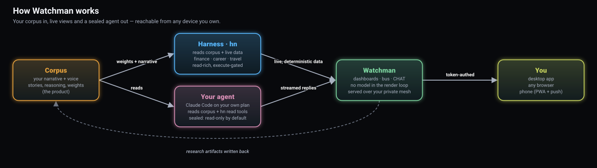
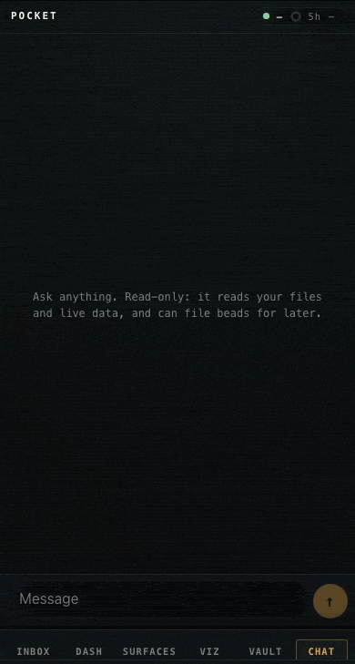
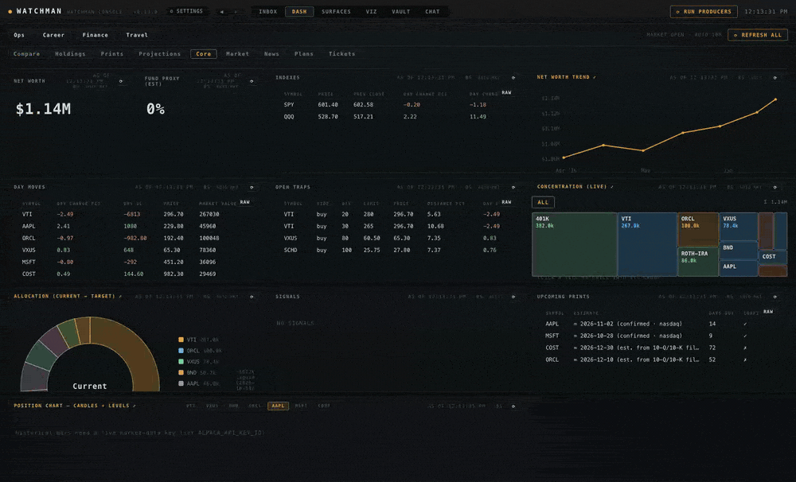
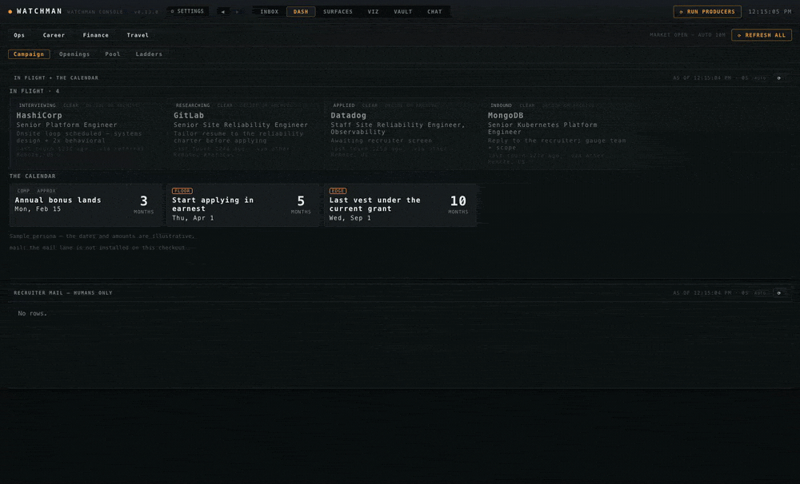
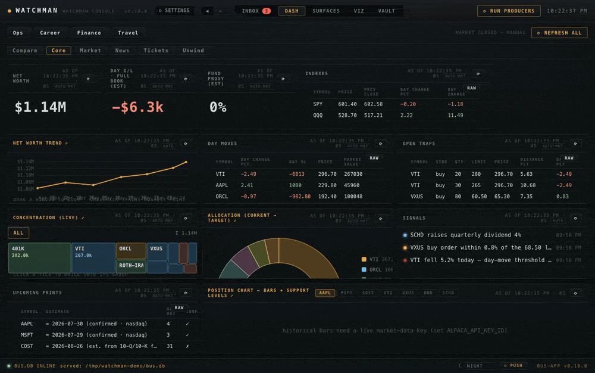

# Watchman

**A console for your own life's data, and a secure line to the agent that works on it.**

Watchman renders live views over your finances, career search and travel from plain files you own. It
also lets you talk to an agent running on your own machine from any device you own, phone included,
over your private network, with the agent sealed to read-only.

**Try it** in one command, on bundled fictional personas:

```bash
docker run --rm -p 8787:8787 ghcr.io/thwomp-io/watchman console demo --host 0.0.0.0
```

Open the URL it prints. Switch personas from the **DEMO** picker in the header. Nothing on your machine
is read, and stopping the container deletes the demo's files.



## Talk to your agent from your phone

The **CHAT** tab is a conversation with an agent on your always-on machine: the Claude Code you already
run, on your own plan. Ask from the phone, and the reply streams back. Tool steps fold into one row.
A status pill shows the model, context use and plan limits.



_A sample persona's pack, replaying a scripted conversation. The packs ship one so you can see the tab
without an agent._

**What the agent can and can't do is enforced by the runner, not by the prompt:**

| | |
|---|---|
| **Reads** | your files, git history, your issue tracker, and the harness's read tools (quotes, net worth, the news wire, roles, trips) |
| **Writes** | issues in your [beads](https://github.com/gastownhall/beads) tracker (its handoff channel), and nothing else unless you grant one narrow writer — the only one today creates a new market-take file and never overwrites one |
| **Never** | file edits, git writes, orders, mail, shell network, or your secrets (config, SSH keys, credentials), which are denied by rule and by the OS sandbox |
| **Reachable** | only through the console's token-authed door on your network; the runner itself opens no port |
| **Proven** | the runner self-tests the seal on every start and serves nothing while a check fails |
| **Audited** | every prompt, tool call and refusal lands in the Inbox |

Setup, the runbook and the full threat model: **[`docs/POCKET.md`](docs/POCKET.md)**.

## See it



_Finance: net worth, the market-take reader, order tickets, earnings-report scorecards, projections and
holdings._



_Career: the campaign in flight, openings ranked by fit with expected comp, the company pool and pay
ladders._

More clips, one per lane: **[`docs/EXAMPLES.md`](docs/EXAMPLES.md)**.

## What's inside

| Part | What it is |
|---|---|
| **Console** | Dashboards that refresh themselves. **Finance:** Core, Market, Tickets, News, Compare, Prints, Projections, Holdings, Plans. **Career:** Campaign, Openings, Pool, Ladders. **Travel:** Planning, Trips, Visits, Calendar, Conditions. **Ops:** Backlog. Plus an Inbox, a viz gallery, a document vault, and **CHAT** |
| **`hn` CLI** | The engine, one lane per domain: `finance` (quotes, net worth, the wire, SEC filings, options gauges, scenario bands) · `career` (keyless job-board scans, pay ladders) · `travel` (flights, hotels, events, weather and conditions) · `beads` (a read-only board over a [beads](https://github.com/gastownhall/beads) tracker) · `pocket` (the CHAT runner) |
| **Bus** | Standing agents publish events; the console shows them, and urgent ones push to your devices |
| **Packs** | Fictional personas that drive every lane, so a fresh install has something to show |

Everything the console shows comes from deterministic commands. No model sits in the render loop or the
alert path; the agent is a separate, opt-in tab.

## Run it

Watchman is a web console the engine serves. Run it on an always-on machine, and every device you own
opens the same page: a browser, the phone (installable as an app), or the optional desktop app.

**1. The demo** (fictional personas, sealed):

```bash
docker run --rm -p 8787:8787 ghcr.io/thwomp-io/watchman console demo --host 0.0.0.0
uv run hn console demo                       # from a checkout, after `npm run build` in bus-app/
```

**2. Your own console**, over your own files:

```bash
uv run hn bus serve --console --ui bus-app/dist     # → http://127.0.0.1:8787/ (asks for the token once)

docker run -p 8787:8787 -v "$PWD/corpus:/corpus" -v watchman-home:/home/watchman \
  ghcr.io/thwomp-io/watchman bus serve --host 0.0.0.0 --console --ui /app/ui
```

A fresh machine gets the full set of built-in dashboards. The console is read-only by default; `--writes`
turns on dashboard editing, pack switching and producer runs for whoever holds the token. Pin a
version tag for anything durable: [`docs/DOCKER.md`](docs/DOCKER.md).

**3. From your phone.** Put the server on a private network. With [Tailscale](https://tailscale.com),
`tailscale serve` gives it an HTTPS address on your tailnet, which the phone needs to install the app and
receive push notifications:

```bash
tailscale serve --bg 8787                           # → https://<machine>.<tailnet>.ts.net/
```

Headscale or any VPN works the same way: bind the server to the private address (`--host`) and pass a
certificate (`--tls-cert` / `--tls-key`). Tokens, phones and push: [`docs/WEB-CONSOLE.md`](docs/WEB-CONSOLE.md).

**4. Optional: the desktop app.** The same console in a window, plus a menu-bar inbox, native
notifications and launch at login. It starts its own local server, or opens a remote one
(**⚙ Settings → Connection**).

| Platform | Install | Note |
|---|---|---|
| **Windows 10/11** | [.exe](../../releases/latest/download/Watchman-Setup-x64.exe) · [.msi](../../releases/latest/download/Watchman-x64.msi) | unsigned: SmartScreen asks once |
| **macOS** (Apple Silicon) | [.dmg](../../releases/latest/download/Watchman-aarch64.dmg) | unsigned: right-click → Open the first time |
| **Linux** | [.deb](../../releases/latest/download/watchman-amd64.deb) | `sudo apt install ./watchman-amd64.deb` |

The app needs [uv](https://docs.astral.sh/uv/). On first launch it spends a minute or two preparing its
engine, then opens on a sample persona.

<details>
<summary><b>Unsigned installers, step by step</b></summary>

- **Windows:** SmartScreen warns because the installer has no paid signing certificate. Choose **More info →
  Run anyway**.
- **macOS:** right-click the app → **Open → Open**. If it is still blocked: **System Settings → Privacy &
  Security → Open Anyway**, or `xattr -d com.apple.quarantine /Applications/Watchman.app`.
- Building from source and running the engine from a shell: [`docs/CLI.md`](docs/CLI.md).

</details>

## Your data, as plain files

A **pack** is a complete persona: one folder per lane, plain YAML and Markdown. Swapping packs re-renders
the whole console.



```
samples/packs/<persona>/
  pack.yaml        name, title, lanes
  finance/         portfolio.yaml, net-worth history, narrative
  career/          watchlist.yml, applications.yaml, company notes
  travel/          weights.yaml, trips/
  pocket/          replay.json — the scripted CHAT demo
  dashboards/      the console this persona describes (optional)
```

The weights are readable config, not a model. From the bundled `demo-investor` persona:

```yaml
# finance/portfolio.yaml
holdings:
  - {symbol: VTI,  account: taxable, shares: 900, avg_cost: 238.40, type: etf}
watchlist:
  - {symbol: NVDA, note: "megacap semis"}
pulse:
  day_move_pct: 5.0      # flag a holding that moves more than this in a day
```

Your real data lives outside the repo (`TRACKER_PATH`). `hn init <dir>` scaffolds one. The
[corpus-operator skill](skills/corpus-operator/SKILL.md) teaches an AI agent to build and maintain it from
conversation, in your own words.

## Posture

- **Read-only by default.** The finance lane reads public prices and a local file. No brokerage
  credentials, and nothing places an order. The agent is sealed the same way.
- **Private by construction.** Outbound calls carry a tool-only User-Agent. The server binds localhost
  unless you point it at your private network, and every API route requires the token.
- **Demo mode is sealed.** With a sample persona active, the console renders only that pack and never
  falls back to a real corpus on the machine.
- **Deterministic core.** Thresholds, alerts and dashboards run without a model; agents work alongside,
  out of the loop.

## Docs

| | |
|---|---|
| [`docs/POCKET.md`](docs/POCKET.md) | the CHAT agent: setup, runbook, threat model |
| [`docs/EXAMPLES.md`](docs/EXAMPLES.md) | a clip for every lane |
| [`docs/WEB-CONSOLE.md`](docs/WEB-CONSOLE.md) | serving the console, tokens, phones, push |
| [`docs/CLI.md`](docs/CLI.md) | the engine from a shell, building from source |
| [`docs/BEADS.md`](docs/BEADS.md) | the beads backlog tab and ticket pages |
| [`docs/BUS.md`](docs/BUS.md) | publishing events from any language |
| [`docs/DOCKER.md`](docs/DOCKER.md) | the container image |
| [`skills/`](skills/) | agent skills: building your corpus, operating the console |
| [`SECURITY.md`](SECURITY.md) · [`CONTRIBUTING.md`](CONTRIBUTING.md) | |

## License

[Apache-2.0](LICENSE).
