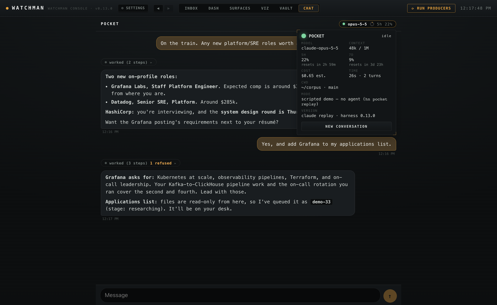

# The pocket agent

A read-only chat with an agent lane, from the phone. The served console's **CHAT** tab sends a message;
a runner on the always-on node answers it with the operator's installed Claude Code CLI, headless, on
the operator's own subscription, inside a permission set the agent cannot widen.

## Runbook

1. **Kill switch**: stop the runner's service (`launchctl bootout gui/$(id -u)/<label>`) — the runner stops; the
   CHAT tab reads "offline" and queued messages wait. Nothing else depends on it.
2. **Start**: run `hn pocket run` as a user service that restarts on exit — a LaunchAgent with `KeepAlive` on
   macOS (`launchctl bootstrap gui/$(id -u) ~/Library/LaunchAgents/<label>.plist`), or a systemd user unit.
3. **Health**: `hn pocket status` · `launchctl print gui/$(id -u)/<label>` (runs, last
   exit code) · the unit log (`harness-pocket.log`) · `pocket_seal` / `pocket_turn` / `pocket_denied`
   events in the Inbox (lane `pocket`).
4. **Prove the seal** any time: `hn pocket selftest` (one cheap model call). `hn pocket show-command`
   prints the exact invocation and settings file.
5. **New conversation**: the status card's NEW CONVERSATION, or `hn pocket reset`. Old transcripts move
   to `<state>/pocket/archive/`.
6. **Seal failed** (red pill, an ALERT in the Inbox): read the failures in the card or
   `hn pocket selftest`; fix; `launchctl kickstart -k gui/$(id -u)/<label>`. While the
   seal fails the runner serves nothing and re-checks every 15 minutes.

## How it works

```
phone (PWA, mesh) ──POST /api/invoke/pocket_send──▶ console door ──writes──▶ <state>/pocket/queue/*.json
                                                                                     │ (polled)
CHAT tab ◀──pocket_state (transcript · live · status)── door ◀──reads── runner ◀────┘
                                                                         │
                                                       claude -p (sealed) ── harness-mcp (read tools)
                                                                         │
                                                                   bus: pocket_turn / pocket_denied
```

- **The door never runs an agent.** It reads the runner's files and writes exactly two things: a prompt
  file and a stop/reset flag. The runner has no listener at all.
- **One writer.** The runner alone writes the transcript, the status and the live (streaming) text.
- **One conversation**, resumed by session id across turns (`--resume`); a reset archives it.
- **Streaming**: the runner rewrites `live.json` on every text delta; the tab polls every 0.8s while a
  reply is in flight, every 4s otherwise, and not at all while the page is hidden.
- **Status pill** data comes from the CLI's own stream: `system/init` (model, tools, MCP status),
  `rate_limit_event` (the plan's 5-hour and 7-day utilization and resets — present on subscription
  logins), assistant `usage` (context used), and `result` (cost estimate, duration, context window).

## Demo: the scripted replay

`hn pocket replay` serves a scripted conversation to the CHAT tab with no agent and no model: it builds the
same stream events the CLI emits and runs them through the same parser and store. The status card reads
"scripted demo — no agent". Every sample pack ships `pocket/replay.json`; a pack's script answers whatever
is typed with its next turn, or `--autoplay` plays the script's own messages. A sealed demo console with
the replay running: `node bus-app/e2e/sealed-serve.mjs --pack demo-investor --replay`.



## Auth and billing

The runner drives the unmodified `claude` binary on the operator's own login (`claude auth status` →
`claude.ai`, or a `claude setup-token` token in `CLAUDE_CODE_OAUTH_TOKEN`). Usage counts against the
plan's windows; nothing is billed per token. `ANTHROPIC_API_KEY` and `ANTHROPIC_AUTH_TOKEN` are removed
from the child environment, because `-p` uses an API key whenever one is present. The cost shown in the
card is the CLI's list-price estimate, not a bill.

## The seal (threat model)

The line the seal holds: **the agent reads; it never writes files, runs write verbs, reaches the
network from its shell, or reads secrets — even if the model is wrong or steered by text it read.**
The model's instructions say so too, but nothing depends on them.

| Layer | What it does | Why it is needed |
|---|---|---|
| `--restricted` | ignores user/project/local settings files | without it, the working directory's own `.claude/settings.json` merges in and can grant Bash/Write rules meant for desktop sessions |
| `--tools Read,Grep,Glob,Bash` | the only built-ins that exist | Write/Edit are absent, not just denied |
| `--strict-mcp-config` + `--mcp-config` | only the harness MCP server loads | `--tools` limits built-ins only; account-level connectors load otherwise |
| `--permission-mode dontAsk` + `--permission-prompts none` | anything not allowed by a rule is refused immediately | no one is there to approve; compound commands, redirects and `$(…)` are checked per subcommand |
| deny rules | write tools, write MCP tools (`bus_ack`, `bus_publish`, `finance_watch`, `finance_research`, `finance_wire_read`, image writers), bead/git write verbs, `rm`/`mv`/`cp`/`curl`/`wget`, and every secret path as `Read(//abs)` + `Read(//abs/**)` (also Grep/Glob) and `**/.env` | deny beats allow, so an overlay that allows too much is still capped. Absolute paths need `//` — a single `/` is settings-relative and silently matches nothing |
| OS sandbox | `enabled`, `failIfUnavailable`, no auto-allow, no unsandboxed retries, `denyRead` on the secret paths, `network.allowedDomains` (empty by default) with `strictAllowlist` | Bash rules match command text and are not a security boundary; the sandbox stops `cat` of a secret at the kernel and blocks shell network. `excludedCommands` is never used — an excluded command loses `denyRead` too |
| live data via MCP | allowlisted harness read tools run outside the sandbox and read their own provider keys | the keys never enter the sandboxed shell, so the shell needs neither the secrets nor the network |
| one sanctioned write | `finance_take_write`, granted only via `mcp_writes`: it takes a body, never a path; the file name is the clock's under `finance/market/takes/`; create-only (`O_EXCL`+`O_NOFOLLOW`); the writer owns the frontmatter; the author comes from the host's MCP env; no git | an agent lane can file a market take without any general write capability; the live probe proves a shell write into `takes/` is still refused |
| self-test | static checks + a live probe (a cheap model told to read a canary in a sealed dir and to write two files) on every start | invalid settings are ignored silently in `-p` mode; nothing is trusted until it is proven |

Mandatory secret paths: the harness config dir, `~/.ssh`, `~/.aws`, `~/.gnupg`, `~/.config/gh`,
`~/.netrc`, `~/.git-credentials`, `~/.claude.json`, `~/.claude/.credentials.json`, `~/Library/Keychains`
(plus the overlay's `deny_read`).

**Read tools added for takes**: `finance_global`, `finance_calendar`, `finance_watch_peek` (seen-marking
fixed off) and `finance_wire_read_match`, which reads only an article whose headline is on the configured
feeds (no URL argument — the URL form stays denied).

**Out of scope / accepted**: what the agent may read is everything else the operator's user can read
outside those paths (that is the point of a read-only assistant); the harness MCP read tools reach their
providers; filing issues with the `bd` (beads) tracker writes its local database. Network reachability is the mesh's job —
the door is already token-authed and bound to the mesh interface.

## Configuration

The overlay's `pocket.global_settings`: `cwd`, `actor`, `model`, `effort`, `boot_prompt`, `allow`, `mcp_tools`,
`mcp_writes`, `add_dirs`, `deny_read`, `network_domains`, `max_prompt_chars`, `selftest_on_start`, `selftest_model`
(each documented in `src/harness/pocket/config.py`). Defaults describe a
generic read-only assistant in the corpus root: bead reads and filing, git history reads, and the
harness read tools for finance, career, travel and the bus.

## Roadmap

1. **Ask mode** (current): one conversation, read-only, streamed, status pill, the bus audit.
2. **Approvals**: a write-class request waits, pushes a `needs_input` notification, and runs only on an
   approve in the tab (`--permission-prompts host` with a permission-prompt tool).
3. **Sessions**: a conversation list; resume a named lane session.
