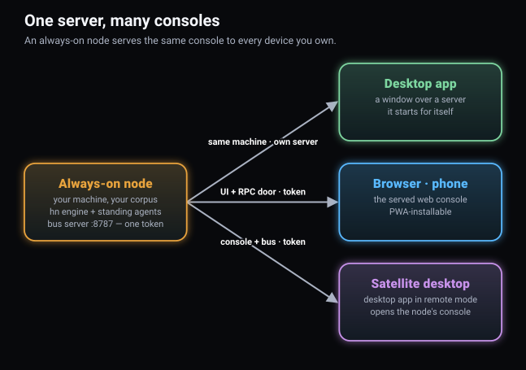
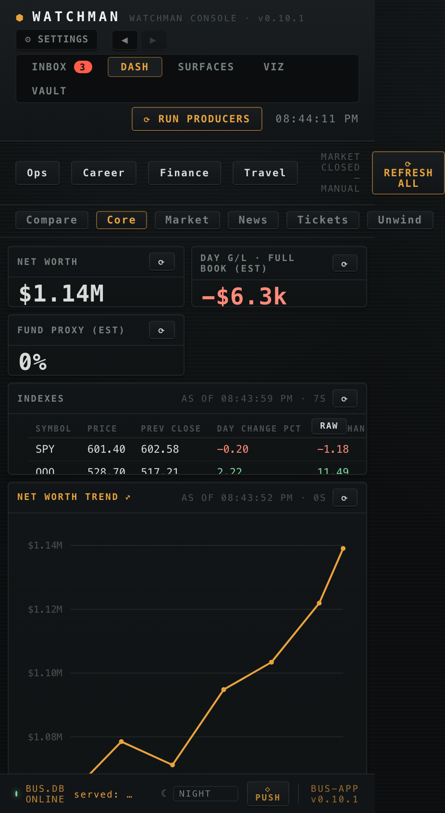

# The web console

The Watchman console is a web page the engine serves: dashboards, inbox, viz, vault and CHAT, behind the
same bearer token the bus API already uses. One server, one token, one bind. Browsers, phones and the
optional desktop app all open this same page; the desktop app is a window over a server it starts for
itself, or over yours.

Run it on an always-on machine over a private network or mesh (Tailscale, Headscale, a home VPN) and
every device you own has the console at one URL — including your phone.



## Serve it

Build the console once, then hand the built directory to the server:

```bash
cd bus-app && npm install && npm run build     # → bus-app/dist
uv run hn bus serve --console --ui bus-app/dist
```

- `--console` mounts the RPC door the frontend talks to (`POST /api/invoke/{cmd}`, read-only unless
  `--writes` enables named writes). `--ui` implies it.
- The server binds `127.0.0.1:8787` by default. To reach it from other devices, bind a private-network
  address deliberately (`--host 100.x.y.z`) — every `/api` route requires the token regardless of bind.
  Prefer the overlay/mesh address over `0.0.0.0`: the plain-HTTP unit carries the bearer token in
  cleartext, so a wildcard bind also puts that token on whatever wifi segment the node sits on. A
  node reaches its own overlay address too, so local tooling (screenshot tooling, health probes)
  can use it instead of loopback.
- Changing `--host` in a launchd plist needs a **bootout + bootstrap** (`launchctl bootout gui/$UID/<label>`
  then `launchctl bootstrap gui/$UID <plist>`) — `kickstart -k` restarts the *loaded* definition and
  keeps the old arguments. If bootstrap returns `Input/output error` right after the bootout, wait a
  couple of seconds and retry; the unload is asynchronous.
- Open `http://<host>:8787/`. The page prompts for the token on first visit and remembers it.

## The token

The bearer token auto-generates to `~/.config/harness/bus-token` (mode `0600`) the first time the
server runs. Two ways to give it to a browser:

1. **Paste it at the prompt** — the page asks once and stores it locally. This is the intended path.
2. **`?token=<value>` in the URL** — convenient for bookmarking on your own devices; the page adopts it
   and cleans the URL.

A wrong or stale token doesn't render as a broken console — the page re-prompts. The token is
defense-in-depth, not the perimeter: keep the transport private (mesh ACLs, VPN, or TLS termination in
front) and treat the bind address as the deliberate act it is.

## Phones + PWA

The console is responsive down to phone widths and ships a web-app manifest: **Add to Home Screen** on
iOS/Android installs it standalone — no browser chrome, safe-area aware, with the zone tabs along the
bottom where thumbs live. Day-to-day it reads like a native finance app pointed at your own data.
At phone widths the VAULT zone is a master-detail flow: the document tree is the page, opening a doc
swaps to a full-width reader with a **◀ back** control.

The **CHAT** zone (served console only) is a read-only conversation with an agent lane running on the
serving node — streamed replies, tool activity folded into one row, and a status pill for context and
plan limits. It needs the pocket runner unit; setup and the security model: [`POCKET.md`](POCKET.md).



## Push notifications

The console can push **alert/warn** bus events to your devices as native notifications — the wire's
`info` skim-stream and filings deliberately never push (spec: [`BUS.md`](BUS.md) → Web push).

Arm it from the **footer bell** (`◇ PUSH`, bottom-right, browser/PWA only): one tap asks for
notification permission, subscribes the device, and flips to `◆ PUSH ARMED` with a **TEST** button that
round-trips a real push through the pipeline. Tap again to disarm. `hn bus push-keys` on the serving
node lists what's subscribed.

Platform notes:

- **iOS (16.4+)**: push only exists for a PWA **installed to the Home Screen** — in-browser Safari
  shows the bell dimmed with the install hint. Install (Share ▸ Add to Home Screen), open the app,
  then arm the bell.
- **Secure context required**: `localhost` counts (the flow is fully testable locally without TLS);
  any other origin — including a tailnet IP — needs HTTPS. That's what the TLS section below is for.
- Everything is account-free and self-hosted except the browser vendors' push relays
  (Apple/Google/Mozilla), which only ever carry ciphertext — payloads are end-to-end encrypted by the
  Web Push protocol, and the harness keeps them minimal regardless.

## HTTPS with Tailscale

A phone needs HTTPS to install the console as an app and to receive push notifications. On a Tailscale
tailnet, keep the server on loopback and let Tailscale terminate TLS:

```bash
uv run hn bus serve --console --ui bus-app/dist     # 127.0.0.1:8787
tailscale serve --bg 8787                           # → https://<machine>.<tailnet>.ts.net/
```

This needs MagicDNS and HTTPS certificates enabled for the tailnet. The address is reachable only inside
the tailnet. Headscale and other VPNs use the next section instead.

## TLS — serving HTTPS directly

`hn bus serve --tls-cert cert.pem --tls-key key.pem` (env: `HARNESS_TLS_CERT`/`HARNESS_TLS_KEY`) has
uvicorn terminate TLS itself — no reverse-proxy daemon to install, configure, and keep patched.

The intended private-mesh deploy (no port-forwarding, nothing public):

1. **A real hostname pointed at the tailnet IP**: create a subdomain at any DNS provider
   with API support for DNS-01 resolving to the serving node's overlay address (e.g. `100.64.0.1`). The name is
   public; the address it points to is only reachable inside the mesh.
2. **A real certificate via DNS-01**: mint with [lego](https://go-acme.github.io/lego/) (or any ACME
   client) using the DNS-01 challenge — it proves control of the *name*, so no inbound reachability
   is ever needed. Renewal is the same command on a timer.
3. **Serve TLS on a second port, keep `:8787` plain**: existing satellites (native watchmen in
   `bus_url` mode) keep their mesh-plain endpoint; the phone gets the secure origin push requires.

   ```bash
   hn bus serve --host 100.64.0.1 --port 8787 --console --ui bus-app/dist &   # satellites, unchanged
   hn bus serve --host 100.64.0.1 --port 8788 --console --ui bus-app/dist \
     --tls-cert /path/to/console.example.crt --tls-key /path/to/console.example.key
   ```

4. On the phone, open `https://console.example.com:8788/`, install to Home Screen, arm the bell.

Both flags or neither — half a TLS pair is a config error, never a silent plain-HTTP fallback. The
token model is unchanged: TLS is transport privacy; the bearer token stays the auth.

## What it can and can't do

The web console is **read-only by default**. The RPC door serves the console's read commands
(dashboards, widgets, the inbox, the vault browser, viz) and allows exactly one write: marking inbox
events read. Switching packs, saving dashboards and running producers answer 403 unless the serve
enables them.

A fresh machine gets the full console: the engine ships the built-in dashboards and seeds any missing
tab into `~/.config/harness/dashboards/` on first load. A file there overrides its default.

It serves the corpus of the operator who launched it. To try the console without a corpus, run the
sealed demo:

```bash
uv run hn console demo          # from a checkout with a built UI (npm run build in bus-app/)
docker run --rm -p 8787:8787 ghcr.io/thwomp-io/watchman console demo --host 0.0.0.0
```

It stages a scratch root (config, state, cache, bus, an empty corpus), opens on a sample persona,
plays that persona's scripted CHAT, and lets you switch personas from the header. Only the bundled
sample packs are selectable, and a sample pack is sealed: its vault, spawns, bus and caches never
reach a real corpus on the machine. Ctrl-C deletes the scratch root.

## Many consoles, one server

`--ui` repeats. A bare directory mounts the default console at `/`; `name=DIR` entries mount variants
at `/ui/<name>/`:

```bash
uv run hn bus serve --console \
  --ui bus-app/dist \
  --ui experiment=/path/to/branch-dist
```

Variant builds must be Vite-built with `--base=/ui/<name>/`. This is how you A/B a console change or
serve a phone-tuned build alongside the daily driver without touching it.

## Native satellites

The desktop app can open a served console instead of starting its own: **⚙ Settings → Connection**,
then the server's URL and token. Its window shows that console, and the app delivers that machine's own
notifications off the same bus: per-device delivery, shared read-state. The tray's **Use this
computer's console** switches back. See [`BUS.md`](BUS.md) → *The watchman in remote mode*.

## The pieces

| Surface | What it is |
|---|---|
| `GET /` (+ `/ui/<name>/`) | the served console build(s) |
| `POST /api/invoke/{cmd}` | the RPC door — read-only command mirror, bearer-token gated |
| `GET /api/bus/*` | the bus API the satellites use ([`BUS.md`](BUS.md)) |
| `/api/push/*` | web-push: vapid-key · subscribe · unsubscribe · test — bearer-token gated |
| `GET /health` | open liveness + version — no secret, no data |
